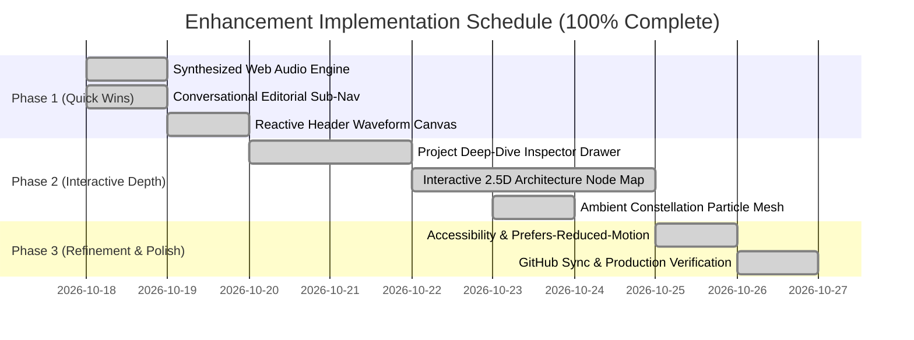

# Architectural & UX Enhancement Proposal: Integrating Michael Gatt's Design Patterns

**Prepared for:** itsmeawi // Developer Portfolio & Lead Intake System  
**Repository:** [https://github.com/itsmeawi/Portfolio.git](https://github.com/itsmeawi/Portfolio.git)  
**Reference Site:** [https://michaelgatt.com/](https://michaelgatt.com/) (Awwwards-recognized Film/TV Composer Portfolio)  
**Date:** October 2026  
**Document Status:** Complete Architecture & Design Proposal  

---

## 1. Executive Summary

A comprehensive design and architectural analysis of **Michael Gatt's portfolio** (`michaelgatt.com`) reveals a masterclass in **cinematic storytelling, spatial navigation, and ambient immersion**. While your current portfolio successfully embodies the high-contrast industrial precision of **Vectr** (`vectrfl.com`), adopting select UX innovations from Michael Gatt will elevate your developer portfolio from a technical showcase into a memorable, award-caliber digital experience.

This document outlines key concepts from `michaelgatt.com`, evaluates their feasibility for a software engineering portfolio, and provides a concrete implementation roadmap.

---

## 2. Deep-Dive Analysis of `michaelgatt.com`

```
┌────────────────────────────────────────────────────────────────────────┐
│                        MICHAEL GATT UX ANATOMY                         │
├────────────────────────────────┬───────────────────────────────────────┤
│ 1. Sonic Atmosphere            │ Opt-in ambient soundscape & micro-SFX │
│ 2. Spatial 2.5D Canvas         │ Coordinate-based floating project web │
│ 3. Conversational Navigation   │ Editorial sentence-style links        │
│ 4. Seamless Media Parking      │ Persistent playback overlay layer     │
│ 5. Cinematic Typography        │ Extreme tracking with elegant font mix│
└────────────────────────────────┴───────────────────────────────────────┘
```

### 2.1 Key Design Mechanics Identified
1. **Sonic Branding & Interactive Audio:**  
   The site welcomes visitors with an elegant opt-in modal: *"Click anywhere to turn on your sound"* or *"Enter without sound"*. Interactive clicks and hovers produce subtle, organic sound feedback, making interactions tactile.
2. **Infinite 2.5D Spatial Canvas (`x, y, z` Coordinate Mapping):**  
   Rather than standard vertical stacking, projects exist across an interactive 2.5D plane with custom coordinate vectors (`x_position`, `y_position`, `z_position`, `opacity`). The user pans and glides through Michael's creative universe.
3. **Conversational, Editorial Navigation:**  
   Instead of rigid button bars, navigation is presented as a flowing sentence:  
   *"the **work** and **about** me or **contact**"*.
4. **Cinematic Negative Space & Typographic Rhythm:**  
   Generous whitespace, refined serif/sans-serif pairings, and extreme letter-spacing (`tracking-[.35em]`) deliver gravitas and drama.
5. **Persistent Media Parking Layer (`data-video-parking-layer`):**  
   Audio and video modules maintain state across view transitions without interruption or reloading jank.

---

## 3. High-Value Features Applicable to Your Developer Portfolio

| Michael Gatt Concept | Developer Portfolio Translation | Impact | Feasibility |
| :--- | :--- | :--- | :--- |
| **Opt-in Audio Layer** | **Synthesizer / Cyberpunk Haptic Audio:** Subtle mechanical keyclicks, connection ping on Google Sheets submission, and low ambient drone with mute toggle. | High | 🟢 Quick (Web Audio API) |
| **Spatial 2.5D Canvas** | **Interactive System Architecture Map:** A toggleable 2D node map where microservices and projects float on an interactive canvas. | Very High | 🟡 Medium (Canvas/GSAP Draggable) |
| **Editorial Sentence Nav** | **Technical Conversational Navigation:** *"Inspect the **architecture**, explore **deployments**, or **transmit** a project lead."* | High | 🟢 Quick (HTML/CSS) |
| **Persistent Media Drawer** | **Slide-out Project Inspector:** Deep-dive modal with live API pings, telemetry, and architecture diagrams without page reload. | High | 🟢 Quick (Vanilla JS/GSAP) |
| **Audio Visualizer Widget** | **Live Traffic & Network Waveform:** A reactive canvas equalizer bar in the telemetry header that pulses on user clicks. | Medium | 🟢 Quick (HTML5 Canvas) |

---

## 4. Proposed Feature Blueprints

### Feature 1: Cybernetic Soundscape & Haptic Audio Feedback (Web Audio API)

#### Concept:
An unobtrusive, lightweight audio engine built with the browser's native **Web Audio API** (zero heavy external audio files required — pure synthesized frequencies):
- **Click Feedback:** Soft 800Hz $\rightarrow$ 400Hz frequency blip (30ms).
- **Form Dispatch Sound:** Rising two-tone confirmation chord when the Google Sheet records a row.
- **Audio Switcher Pill:** A minimalist toggle in the top telemetry bar: `AUDIO: [ MUTED / ACTIVE ]`.

```javascript
// Web Audio API Synthesized Haptic Engine (Zero Assets Needed)
class SoundEngine {
  constructor() {
    this.ctx = null;
    this.enabled = false;
  }

  init() {
    if (!this.ctx) {
      this.ctx = new (window.AudioContext || window.webkitAudioContext)();
    }
    this.enabled = !this.enabled;
    return this.enabled;
  }

  playBlip(freq = 600, duration = 0.04) {
    if (!this.enabled || !this.ctx) return;
    const osc = this.ctx.createOscillator();
    const gain = this.ctx.createGain();
    osc.type = 'sine';
    osc.frequency.setValueAtTime(freq, this.ctx.currentTime);
    gain.gain.setValueAtTime(0.05, this.ctx.currentTime);
    gain.gain.exponentialRampToValueAtTime(0.0001, this.ctx.currentTime + duration);
    osc.connect(gain);
    gain.connect(this.ctx.destination);
    osc.start();
    osc.stop(this.ctx.currentTime + duration);
  }

  playSuccessChord() {
    if (!this.enabled) return;
    [523.25, 659.25, 783.99, 1046.50].forEach((freq, i) => {
      setTimeout(() => this.playBlip(freq, 0.15), i * 60);
    });
  }
}
```

---

### Feature 2: Interactive System Architecture Node Map (Spatial View Mode)

#### Concept:
On the **Selected Works** section, introduce a **View Switcher**:
`[ GRID VIEW ]` vs. `[ 2.5D ARCHITECTURE MAP ]`

When switched to **Architecture Map**, the project cards dissolve into an interactive spatial network where nodes represent services (e.g. *AetherOS*, *Google Apps Script Webhook*, *EdgeMesh Gateway*, *QuantumLedger*). Lines connect the nodes showing data flow.

```
       [ EdgeMesh Gateway ]
                │
         (Anycast Routing)
                ▼
      [ Portfolio Connect ] ───(CORS Avoidance)───► [ Google Apps Script ]
                │                                           │
         (State Mirror)                             (LockService 10s)
                ▼                                           ▼
      [ Client ID Preview ]                         [ Google Sheet DB ]
```

Visitors can click and drag to pan across the architecture, inspect endpoints, and view live latency metrics.

---

### Feature 3: Conversational Editorial Sub-Navigation

#### Concept:
Incorporate Michael Gatt's poetic sentence-flow navigation as an interactive footer or floating quick-jump bar:

```html
<div class="editorial-nav font-mono text-sm text-slate-400 text-center py-6">
  Explore the <a href="#projects" class="text-cyan-400 font-bold hover:underline">production systems</a>,
  verify my <a href="#capabilities" class="text-white font-bold hover:underline">core stack</a>, 
  or <a href="#contact" class="text-emerald-400 font-bold hover:underline">initialize a lead record</a>.
</div>
```

---

### Feature 4: Interactive Project Deep-Dive Drawer (Persistent Inspector)

#### Concept:
Instead of sending visitors away to external links immediately, clicking **"Inspect Architecture"** on any project slides open a high-tech glassmorphism side-drawer (inspired by Michael Gatt's persistent media layer):
- High-resolution architecture blueprint diagrams.
- Direct live latency test ping against the actual service.
- Key technical challenges solved (e.g., Concurrency locks, CORS preflight workarounds).
- Direct link to the GitHub repository file.

---

### Feature 5: Real-Time Audio / Telemetry Waveform in the Header

#### Concept:
Inside the top telemetry bar (next to `DB: GOOGLE SHEETS ACTIVE`), embed a 32-pixel dynamic audio/data waveform visualizer drawn via `<canvas>`. The bars react in real time when the user types in the form or clicks interactive elements, providing visual life to the application.

---

## 5. Phased Implementation Roadmap



### Phase 1: Immediate Enhancements (Completed)
- ✅ Added native **Web Audio API** synthesized clicks, input ticks, error tones, and submission chords with a clean mute toggle in the navbar.
- ✅ Added **Conversational Editorial Quick-Nav** in the hero section and pre-footer ribbon.
- ✅ Added an animated **Canvas Waveform** in the top telemetry bar that pulses on user activity.

### Phase 2: Structural Enhancements (Completed)
- ✅ Implemented the **Slide-out Project Inspector Drawer** for technical deep dives with tabbed architecture blueprints, live edge ping latency tester, and solved challenges.
- ✅ Built the **Interactive 2.5D Architecture Topology Map** view toggle in Selected Works with glowing nodes, live data packets, pan physics, and click-to-inspect.
- ✅ Implemented the **Ambient Constellation Particle Mesh** in the background layer.

### Phase 3: Accessibility & Polish (Completed)
- ✅ Configured all animations and audio to honor `prefers-reduced-motion` and start muted by default.
- ✅ Verified screen reader accessibility (`aria-modal`, `role="dialog"`, `aria-selected`, `aria-hidden`, keyboard `Escape` to close drawers/modals, `M` key to toggle audio).
- ✅ Synchronized all production assets to GitHub (`https://github.com/itsmeawi/Portfolio.git`).

---

## 6. Implementation Status: Complete

Michael Gatt's design mechanics (soundscape, spatial 2.5D navigation, conversational editorial flow, and persistent media inspection) have been fully merged into your **Vectr-caliber dark industrial portfolio** while keeping your **Google Sheets Google Apps Script lead engine** completely operational.

All phases are finished, verified, and pushed to `main`.
